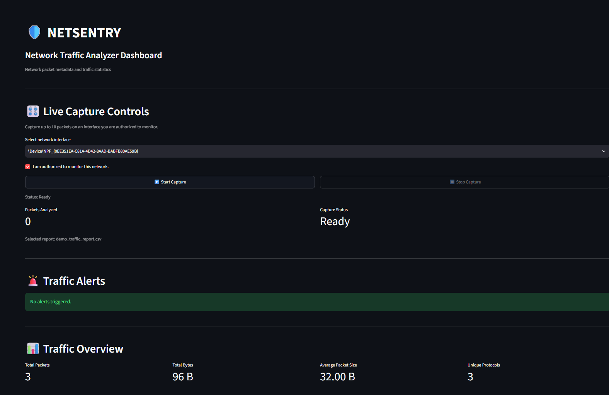

# 🛡️ NETSENTRY — Network Traffic Analyzer

NETSENTRY is a Python-based network traffic analysis project designed for educational use and authorized network monitoring. It analyzes packet metadata, generates traffic statistics, exports CSV reports, and provides an interactive Streamlit dashboard.

## ✨ Features

- **Demo Mode:** Generates synthetic TCP, UDP, and ICMP packets.
- **Live Packet Capture:** Captures a bounded number of packets using Scapy and Npcap.
- **Network Interface Selection:** Lists available network interfaces and supports interface selection.
- **Packet Metadata Analysis:** Extracts timestamps, IP addresses, protocols, ports, and packet lengths.
- **CSV Export:** Exports packet metadata to CSV reports.
- **Traffic Statistics:** Calculates packet counts, total bytes, average packet size, and protocol distribution.
- **Interactive Dashboard:** Displays packet metrics, charts, protocol filters, IP search, and downloadable reports.
- **Traffic Alerts:** Uses simple metadata-based rules to flag high packet counts from a source IP and unusually large packets.
- **Automated Tests:** Tests packet analysis, capture validation, error handling, statistics, and alert rules.

## 🧰 Technology Stack

- Python
- Scapy
- Npcap
- Pandas
- Streamlit
- Plotly
- Pytest
- CSV

## 📸 Dashboard Screenshots

### Demo Dashboard


### Live Packet Capture



### Traffic Analysis


### Packet Records


## 📁 Project Structure

```text
NetSentry/
├── main.py
├── app.py
├── network_sniffer/
│   ├── analyzer.py
│   ├── capture.py
│   ├── exporter.py
│   ├── statistics.py
│   └── alerts.py
├── tests/
│   ├── test_analyzer.py
│   ├── test_capture.py
│   └── test_alerts.py
├── test_statistics.py
├── docs/
│   └── screenshots/
├── reports/
│   ├── demo_traffic_report.csv
│   └── live_traffic_report.csv
└── README.md
```

*Note: This structure lists the main project files; other configuration files may also be present.*

## ⚙️ Requirements

- Windows
- Python installed and available in the terminal
- Npcap for live packet capture
- Required Python packages

## 🚀 Installation

### 1. Clone the repository

```powershell
git clone https://github.com/shelkenivruti683-boop/NetSentry.git
cd NetSentry
```

### 2. Create and activate a virtual environment

```powershell
python -m venv .venv
.\.venv\Scripts\Activate.ps1
```

### 3. Install dependencies

```powershell
python -m pip install scapy pandas streamlit plotly pytest
```

Install Npcap separately using its official installer if it is not already installed.

## ▶️ Run NETSENTRY

### Interactive CLI Menu

```powershell
python main.py
```

Choose an option from the menu