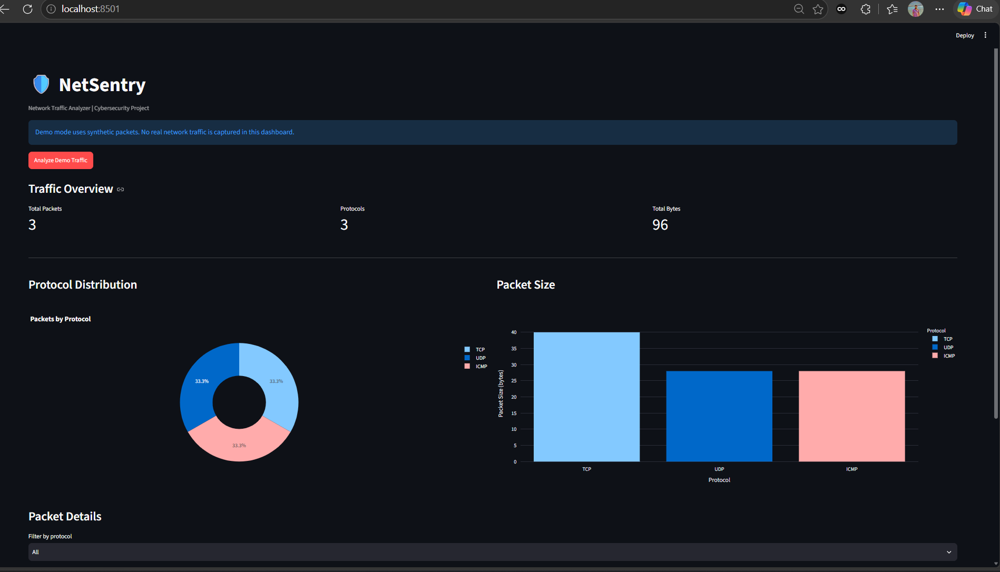
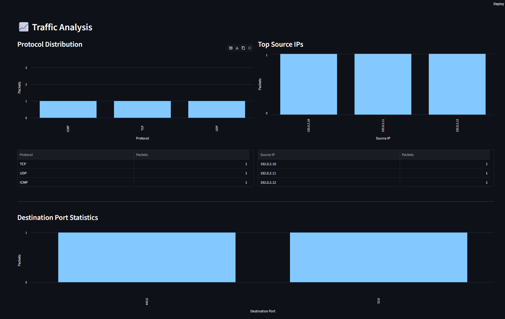
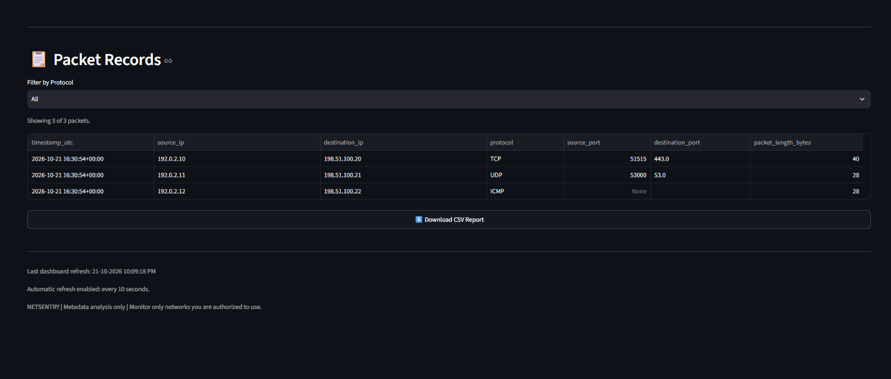

# NETSENTRY — Network Traffic Analyzer

NETSENTRY is a Python-based network traffic analysis project that captures and analyzes packet metadata for authorized network monitoring.

## Features

- **Demo Mode:** Generates synthetic TCP, UDP, and ICMP packets.
- **Live Packet Capture:** Captures a bounded number of packets using Scapy and Npcap.
- **Network Interface Selection:** Selects an available network interface.
- **Packet Metadata Analysis:** Records IP addresses, protocols, ports, timestamps, and packet lengths.
- **CSV Export:** Saves packet metadata to CSV reports.
- **Traffic Statistics:** Calculates packet counts, total bytes, average packet size, and protocol distribution.
- **Interactive Dashboard:** Displays packet metrics, charts, filters, and downloadable reports using Streamlit.
- **Traffic Alerts:** Uses simple metadata-based rules to flag high packet counts from a source IP and large packets.

## Technology Stack

- Python
- Scapy
- Npcap
- Pandas
- Streamlit
- CSV
## Dashboard Screenshots

### Demo Dashboard


### Live Packet Capture


### Traffic Analysis


### Packet Records and CSV Export

## Project Structure

```text
NetSentry/
├── main.py
├── dashboard.py
├── network_sniffer/
│   ├── analyzer.py
│   ├── capture.py
│   ├── exporter.py
│   ├── statistics.py
│   └── alerts.py
└── reports/
    ├── demo_traffic_report.csv
    └── live_traffic_report.csv
```

## Requirements

- Windows
- Python
- Npcap for live packet capture
- Required Python packages installed in the project environment

## Setup

1. Open the project folder in VS Code.
2. Activate your project's Python environment or use its Python executable.
3. Install the required packages if they are not already installed.

```powershell
python -m pip install scapy pandas streamlit
```

Install Npcap separately for live packet capture.

## Run Demo Mode

```powershell
.\.venv\Scripts\python.exe main.py --mode demo
```

## Run the Dashboard

```powershell
.\.venv\Scripts\python.exe -m streamlit run dashboard.py
```

Open the local URL shown in the terminal, usually:

http://localhost:8501

## Reports

Reports are saved as CSV files in the `reports/` directory. They contain packet metadata such as timestamps, source and destination IP addresses, protocol, ports, and packet length.

## Traffic Alerts

The current alert rules use demonstration thresholds. An alert indicates a condition worth reviewing; it does not prove malicious activity.

## Safety and Privacy

- Use live capture only on networks you own or are explicitly authorized to monitor.
- NETSENTRY is designed to analyze packet metadata rather than packet payloads or private message contents.
- Avoid publishing reports containing real IP addresses or other sensitive network information.

## Limitations

- Live capture depends on interface selection, Npcap, permissions, and available network traffic.
- The current capture implementation is bounded to a maximum of 10 packets and up to 30 seconds.
- Traffic alerts are basic indicators and may produce false positives or miss suspicious activity.

## Project Status

Core demo mode, live packet capture, CSV export, Streamlit dashboard, statistics, and basic metadata-based alert rules have been implemented and tested individually.

Additional testing and documentation can improve reliability and usability.

## Author

**Nivrutti Shelke**

- **Project:** NETSENTRY — Network Traffic Analyzer
- **Domain:** Cybersecurity & Network Security
- **Technologies:** Python, Scapy, Streamlit, Pandas
- **Purpose:** Educational project for authorized network traffic monitoring and metadata analysis.
- **GitHub:** [View My GitHub Profile](https://github.com/shelkenivruti683-boop)